<picture><source media="(prefers-color-scheme: dark)" srcset="assets/overview-dark.svg"></picture>
<picture><source media="(prefers-color-scheme: dark)" srcset="assets/commits-dark.svg"></picture>

<!-- activity:start -->
**Now building** · [snisplit](https://github.com/Giang-Dang/snisplit) · Rust · pushed 14 Nov · 60 commits this year 
› Milestone 3 done: kill, stale-rule removal and cleanup verified

**Latest tags** · [mosaic-graph](https://github.com/Giang-Dang/mosaic-graph) `ch18` · [rnn-to-transformer-lab](https://github.com/Giang-Dang/rnn-to-transformer-lab) `ch11`

Counts include private work · repo lists are public only · updated 14 Nov 2026
<!-- activity:end -->
